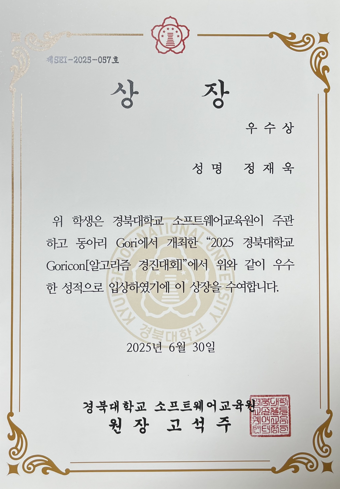

# IT 포트폴리오

## 목차
- [1. 자기소개](#1-자기소개)
- [2. 나에 대한 소개](#2-나에-대한-소개)
- [3. 기술 스택](#3-기술-스택)
- [4. 프로젝트](#4-프로젝트)
  - [4.1. 방탈출 - 동래구 기록 복구 프로젝트](#41-방탈출---동래구-기록-복구-프로젝트)
  - [4.2. 학습 및 성적 관리 시스템](#42-학습-및-성적-관리-시스템)
- [5. 경험 및 활동](#5-경험-및-활동)
  - [5.1. 개발 관련 학습 및 교육](#51-개발-관련-학습-및-교육)
  - [5.2. 기술 관련 활동 및 수상 내역](#52-기술-관련-활동-및-수상-내역)
  - [5.3. 개발 봉사 및 사회공헌 활동](#53-개발-봉사-및-사회공헌-활동)
- [6. 자격증](#6-자격증)
- [7. 학습 및 성장](#7-학습-및-성장)
- [8. 연락처](#8-연락처)

## 1. 자기소개

## 2. 나에 대한 소개
- **전공**: 경북대학교 컴퓨터학부 글로벌SW융합전공
- **관심 분야**: 웹 백엔드 개발
- **성격 및 강점**:

## 3. 기술 스택
- **Programming Languages**: Java, Python, C++, C
- **Frontend**: HTML, JavaScript
- **Backend**: JSP, Servlet, JDBC
- **Database**: Oracle SQL
- **Server**: Apache Tomcat
- **Cloud & Infrastructure**: AWS EC2, AWS S3
- **GUI Development**: Tkinter, Java Swing
- **Tools & Development Environment**: Eclipse, Visual Studio Code

## 4. 프로젝트
### 4.1. 방탈출 - 동래구 기록 복구 프로젝트
- **프로젝트명 및 소개**: 동래구 기록 복구 프로젝트는 봉사자들이 봉사 정신을 함양할 수 있도록 제작된 웹 기반 방탈출 게임 프로그램이다. 플레이어는 제한 시간 내에 각종 문제를 풀어 방탈출을 시도할 수 있고, 관리자는 플레이어별 게임 플레이 기록을 확인할 수 있다.
- **프로젝트 개발 목적**: 봉사자들이 게임 형식을 통해 더욱 흥미롭게 봉사 정신을 함양할 수 있도록 교육용으로 개발되었다. 또한 관리자가 각 봉사자별 게임 기록을 확인하고, 조건에 부합하는 봉사자의 봉사 시간을 1365 자원봉사포털 사이트에 입력할 수 있도록 도와준다.
- **사용 기술**
  - **Frontend**: HTML, CSS, JavaScript
  - **Backend**: Java, JSP, Servlet
  - **Database**: Oracle SQL
  - **Tools**: Eclipse, Github
- **담당 역할**: Java, HTML, JavaScript 대부분(admin.js, bgm_audio.js, chat.js, main_theme.js, problem_set.js, session_storage_manager.js, sfx_manager.js, sound_button.js, timer.js), SQL 개발
- **주요 구현 기능**
  | 기능 | 사용자 유형 | 설명 |
  | --- | -------- | --- |
  | 제한 시간 | 봉사자 | 40분 동안 게임 진행 |
  | 문제 풀이 | 봉사자 | 각 방의 오브젝트를 클릭해 문제 해결 |
  | 오답 처리 | 봉사자 | 문제 해결에 실패할 경우 남은 시간 30초 감소 |
  | 힌트 시스템 | 봉사자 | 문제 해결에 필요한 힌트를 제공하고 남은 시간 1분 감소 |
  | 플레이어 상태창 | 봉사자 | 이름, 이해도, 남은 시간, 아이템, 코드 출력 |
  | 엔딩 시스템 | 봉사자 | 게임의 성공 여부에 따른 엔딩 구성 설정 |
  | 대시보드 조회 | 관리자 | 게임 이용 현황(전체 사용자 수, 게임 성공 사용자 수, 게임 실패 사용자 수, 최근 접속 사용자 10명, 사용자별 최근 게임 기록) 조회 |
  | 사용자 조회 | 관리자 | 1365에 가입되어 있는 ID를 바탕으로 사용자별 게임 진행 상황(게임 성공 여부, 접속 시간, 종료 시간, 최근 마지막 해결 방, 최근 마지막 해결 오브젝트 등) 조회 |
  | 플레이 기록 조회 | 관리자 | 최근 50명 사용자들의 플레이 기록(접속 시간, 마지막 해결 방, 마지막 해결 오브젝트, 게임 성공 여부, 이해도) 조회 |
  | 플레이 통계 조회 | 관리자 | 전체 사용자들의 게임 플레이 기록의 통계 조회 |
- **Github 저장소 및 시연 링크**
  - **Github 저장소**: https://github.com/uk3181/DongnaeEscape
  - **봉사자용 시연 링크**: http://dongnae-escape.kro.kr
  - **관리자용 시연 링크**: http://dongnae-escape.kro.kr/admin
### 4.2. 학습 및 성적 관리 시스템
- **프로젝트명 및 소개**: J Study Checker는 학습 시간과 성적을 통합적으로 관리하고 분석할 수 있는 Windows 기반 학습 관리 프로그램이다. 학습 기록, 과목별 통계, 성적 분석 및 예측, 타이머 등의 기능을 제공한다.
- **프로젝트 개발 목적**: 학습 시간과 휴식 시간을 분리해 관리하고 집중도를 분석하며, 성적 변화 및 예측을 시각적으로 나타내어 사용자가 자신의 학습 습관과 성적 간의 상관관계를 파악할 수 있도록 하였다. 이를 통해 성적이 상대적으로 부족한 과목을 보완할 수 있는 기대 효과를 가져온다.
- **사용 기술**
  - **Language**: Python
  - **GUI**: Tkinter
  - **Data Analysis**: Numpy, Scikit-learn
  - **Visualization**: Matplotlib
  - **Data Management**: Pickle, SortedContainters, Datetime
- **담당 역할**: Python 개발
- **주요 구현 기능**
  | 기능 | 사용자 유형 | 설명 |
  | --- | -------- | --- |
  | 사용자 등록 | 일반 사용자, 사용자 시스템 | ID, 비밀번호, 이름, 나이, 성별을 바탕으로 새로운 사용자 등록 |
  | 로그인 | 일반 사용자, 사용자 시스템 | ID, 비밀번호를 바탕으로 로그인 |
  | 학습 시작 | 일반 사용자 | 선택된 과목의 학습 시간 기록 |
  | 학습 시간 분석 | 학습 분석 시스템, 일반 사용자 | 스톱워치가 정지된 시간을 제외한 시간 계산 |
  | 휴식 시간 분석 | 학습 분석 시스템, 일반 사용자 | 스톱워치가 정지된 시간 계산 |
  | 집중도 분석 | 학습 분석 시스템, 일반 사용자 | 학습 시간을 학습 시간과 휴식 시간의 합으로 나눈 값 계산 |
  | 성적 데이터 분석 | 성적 분석 시스템, 일반 사용자 | 각 성적을 시계열로 분석하고 선형 회귀 분석을 통해 성적 예측 |
  | 리마인더 관리 | 일반 사용자, 알림 시스템 | 리마인더 확인 및 수정·삭제 |
  | 리마인더 알림 업데이트 | 알림 시스템 | 사용자가 앱을 사용하는 날짜에 해당하는 리마인더가 있는지 확인하고, 있을 경우 사용자의 알림 목록에 리마인더 알림 추가 |
  | 사용자 정보 변경 알림 업데이트 | 알림 시스템 | 사용자 정보가 변경될 때마다 사용자 알림 목록에 사용자 정보 변경 알림 추가 |
- **Github 저장소 및 시연 링크**
  - **Github 저장소**: https://github.com/uk3181/J-Study-Checker
  - **다운로드**: https://github.com/uk3181/J-Study-Checker/releases/download/v1.0/J.Study.Checker.Installer.exe
  - **설치**: J.Study.Checker.Installer.exe 실행 후 안내에 따라 설치 진행

## 5. 경험 및 활동
### 5.1. 개발 관련 학습 및 교육
- 알고리즘 스터디
  <table>
    <tr>
      <td><b>활동 기간</b></td>
      <td>2025년 4월 ~ 2025년 10월</td>
    </tr>
    <tr>
      <td><b>활동 유형</b></td>
      <td>알고리즘 및 문제 해결 스터디</td>
    </tr>
    <tr>
      <td><b>학습 내용</b></td>
      <td>
        <ul>
          <li>동적 계획법, 그리디, 그래프 등 상대적으로 부족했던 알고리즘 분야 집중 학습</li>
          <li>트라이, 투 포인터 등 고급 알고리즘 학습 및 문제 해결 능력 강화</li>
          <li>서울대학교 SCPC, ICPC 등 각종 알고리즘 대회 참가</li>
          <li>알고리즘 문제 풀이 과정과 구현 코드를 공유하고 설명하는 역량 강화</li>
        </ul>
      </td>
    </tr>
    <tr>
      <td><b>활동 성과</b></td>
      <td>
        <ul>
          <li>ICPC 본선 진출</li>
          <li>Goricon 알고리즘 경진대회 우수상 수상</li>
        </ul>
      </td>
    </tr>
  </table>
### 5.2. 기술 관련 활동 및 수상 내역
- Goricon 알고리즘 경진대회 우수상
  <table>
    <tr>
      <td><b>대회명</b></td>
      <td>Goricon (알고리즘 경진대회)</td>
    </tr>
    <tr>
      <td><b>수상 기관</b></td>
      <td>경북대학교 소프트웨어교육원</td>
    </tr>
    <tr>
      <td><b>수상 날짜</b></td>
      <td>2025년 6월 30일</td>
    </tr>
    <tr>
      <td><b>주요 내용</b></td>
      <td>제한 시간 안에 알고리즘 문제를 풀고 코드를 작성하는 대회</td>
    </tr>
    <tr>
      <td><b>상장</b></td>
      <td></td>
    </tr>
  </table>
- ICPC 본선 진출
  <table>
    <tr>
      <td><b>대회명</b></td>
      <td>ICPC Asia Seoul Regional Onsite Contest</td>
    </tr>
    <tr>
      <td><b>대회 단계</b></td>
      <td>서울 지역 본선</td>
    </tr>
    <tr>
      <td><b>참가 날짜</b></td>
      <td>2025년 11월 22일</td>
    </tr>
    <tr>
      <td><b>참가 확인서</b></td>
      <td></td>
    </tr>
  </table>
### 5.3. 개발 봉사 및 사회공헌 활동
- 웹기반 방탈출 개발 프로젝트 봉사
  <table>
    <tr>
      <td><b>활동명</b></td>
      <td>웹기반 방탈출 개발 프로젝트 봉사</td>
    </tr>
    <tr>
      <td><b>활동 목적</b></td>
      <td>게임을 통한 봉사 정신 함양 및 교육 지원</td>
    </tr>
    <tr>
      <td><b>담당 역할</b></td>
      <td>웹 애플리케이션 개발</td>
    </tr>
    <tr>
      <td><b>활동 내역</b></td>
      <td><a href="https://github.com/uk3181/DongnaeEscape">[Github] 방탈출 - 동래구 기록 복구 프로젝트</a></td>
    </tr>
  </table>

## 6. 자격증

## 7. 학습 및 성장

## 8. 연락처
- **Email**: uk3181@daum.net
- **Github**: https://github.com/uk3181
- **Instagram**: https://www.instagram.com/jaewook3181
