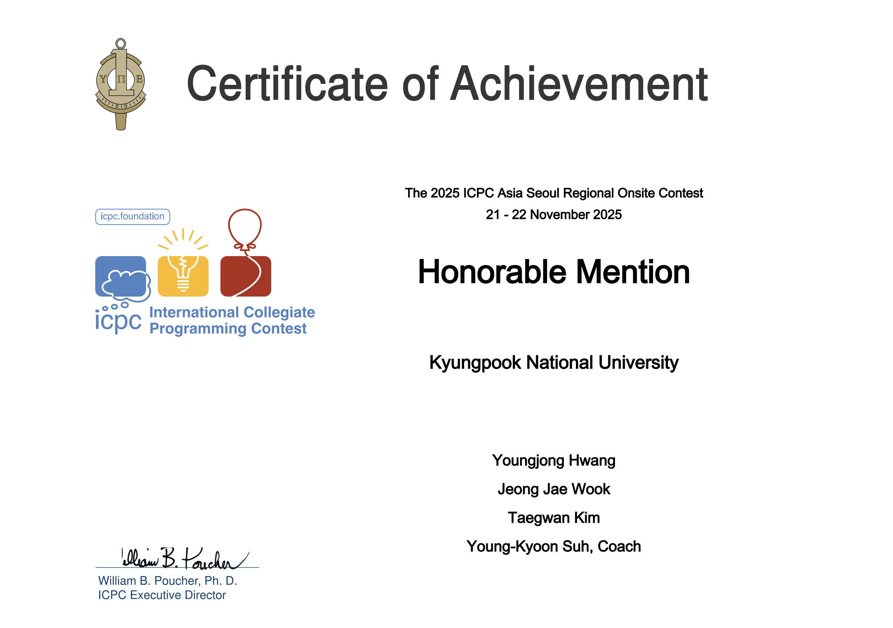

# IT 포트폴리오

<table id="table-of-contents">
  <tr>
    <td>
      <b>목차</b>
      <ul>
        <li><a href="#1-자기소개">1</a>. 자기소개</li>
        <li><a href="#2-기술-스택">2</a>. 기술 스택</li>
        <li>
          <a href="#3-프로젝트">3</a>. 프로젝트
          <ul>
            <li><a href="#31-방탈출---동래구-기록-복구-프로젝트">3.1</a>. <a href="https://github.com/uk3181/DongnaeEscape">방탈출 - 동래구 기록 복구 프로젝트</a></li>
            <li><a href="#32-학습-및-성적-관리-시스템">3.2</a>. <a href="https://github.com/uk3181/J-Study-Checker">학습 및 성적 관리 시스템</a></li>
          </ul>
        </li>
        <li>
          <a href="#4-경험-및-활동">4</a>. 경험 및 활동
          <ul>
            <li><a href="#41-개발-관련-학습-및-교육">4.1</a>. 개발 관련 학습 및 교육</li>
            <li><a href="#42-기술-관련-활동-및-수상-내역">4.2</a>. 기술 관련 활동 및 수상 내역</li>
            <li><a href="#43-개발-봉사-및-사회공헌-활동">4.3</a>. 개발 봉사 및 사회공헌 활동</li>
          </ul>
        </li>
        <li><a href="#5-자격증">5</a>. 자격증</li>
        <li><a href="#6-연락처">6</a>. 연락처</li>
      </ul>
    </td>
  </tr>
</table>

## [1](#table-of-contents). 자기소개
- **전공**: 경북대학교 컴퓨터학부 글로벌SW융합전공
- **관심 분야**: 웹 백엔드 개발
- **성격 및 강점**
  - 프로그래밍 역량: 정확하고 효율적인 방법으로 프로그래밍을 하는 데 자신이 있다. 또한 클라이언트의 요구 사항을 프로젝트에 정확히 반영하는 데 자신이 있다. 파이썬 중형 팀 프로젝트 과제가 포함된 대학 교과목에서 [운동 관리 프로그램](https://github.com/uk3181/Fit-Checker)을 직접 기획·개발함으로써 우수한 성과를 거두어 A+ 학점을 취득했다.
  - 디버깅 및 문제 해결 능력: 복잡한 코드에서 문법 오류 및 의도한 대로 동작하지 않는 코드를 신속하게 원인을 파악하고 해결하는 데 자신이 있다. [ICPC 본선 대회](#42-기술-관련-활동-및-수상-내역)에서 특정 문제를 해결하는 과정에서 의도한 동작과 다르게 흘러가는 코드를 팀원이 아무도 찾지 못했는데 내가 빠른 시간 내에 오류가 발생한 부분을 수정하여 팀의 성과에 기여하였다.
  - 섬세함: 작업을 수행할 때 세부적인 부분까지 꼼꼼히 확인하는 습관이 있다. 개발 프로젝트를 수행할 때도 무작정 프로그래밍만 하는 것이 아니라 설계한 시스템 아키텍처를 고려해서 유지보수가 용이하도록 효율적인 개발 방식을 선택한다.
  - 리더십: 팀 프로젝트를 수행할 때 프로젝트 기획·설계·역할 분배를 주도함으로써 프로젝트가 효율적으로 진행될 수 있도록 한다. 대학 교과목 중 \"소프트웨어 설계\" 과목에서 [뇌졸중 위험도 산출 기반 건강 관리 시스템](https://github.com/molto-piu-tranquillo/stroke-risk-health-manager)을 개발하는 팀 프로젝트 활동에서 화면 구성과 기능을 구체화하고 개발 업무 분담을 주도하였다.

## [2](#table-of-contents). 기술 스택
- **Programming Languages**: Java, Python, C++, C
- **Frontend**: HTML, JavaScript
- **Backend**: JSP, Servlet, JDBC
- **Database**: Oracle SQL
- **Server**: Apache Tomcat
- **Cloud & Infrastructure**: AWS EC2, AWS S3
- **GUI Development**: Tkinter, Java Swing
- **Tools & Development Environment**: Eclipse, Visual Studio Code

## [3](#table-of-contents). 프로젝트
### [3.1](#table-of-contents). [방탈출 - 동래구 기록 복구 프로젝트](https://github.com/uk3181/DongnaeEscape)
- **프로젝트명 및 소개**: 동래구 기록 복구 프로젝트는 봉사자들이 봉사 정신을 함양할 수 있도록 제작된 웹 기반 방탈출 게임 프로그램이다. 플레이어는 제한 시간 내에 각종 문제를 풀어 방탈출을 시도할 수 있고, 관리자는 플레이어별 게임 플레이 기록을 확인할 수 있다.
- **프로젝트 개발 목적**: 봉사자들이 게임 형식을 통해 더욱 흥미롭게 봉사 정신을 함양할 수 있도록 교육용으로 개발되었다. 또한 관리자가 각 봉사자별 게임 기록을 확인하고, 조건에 부합하는 봉사자의 봉사 시간을 1365 자원봉사포털 사이트에 입력할 수 있도록 도와준다.
- **사용 기술**
  - **Frontend**: HTML, CSS, JavaScript
  - **Backend**: Java, JSP, Servlet
  - **Database**: Oracle SQL
  - **Tools**: Eclipse, Github
- **담당 역할**: Java, HTML, JavaScript 대부분(admin.js, bgm_audio.js, chat.js, main_theme.js, problem_set.js, session_storage_manager.js, sfx_manager.js, sound_button.js, timer.js), SQL 개발
- **주요 구현 기능**
  | 기능 | 사용자 유형 | 설명 |
  | --- | -------- | --- |
  | 제한 시간 | 봉사자 | 40분 동안 게임 진행 |
  | 문제 풀이 | 봉사자 | 각 방의 오브젝트를 클릭해 문제 해결 |
  | 오답 처리 | 봉사자 | 문제 해결에 실패할 경우 남은 시간 30초 감소 |
  | 힌트 시스템 | 봉사자 | 문제 해결에 필요한 힌트를 제공하고 남은 시간 1분 감소 |
  | 플레이어 상태창 | 봉사자 | 이름, 이해도, 남은 시간, 아이템, 코드 출력 |
  | 엔딩 시스템 | 봉사자 | 게임의 성공 여부에 따른 엔딩 구성 설정 |
  | 대시보드 조회 | 관리자 | 게임 이용 현황(전체 사용자 수, 게임 성공 사용자 수, 게임 실패 사용자 수, 최근 접속 사용자 10명, 사용자별 최근 게임 기록) 조회 |
  | 사용자 조회 | 관리자 | 1365에 가입되어 있는 ID를 바탕으로 사용자별 게임 진행 상황(게임 성공 여부, 접속 시간, 종료 시간, 최근 마지막 해결 방, 최근 마지막 해결 오브젝트 등) 조회 |
  | 플레이 기록 조회 | 관리자 | 최근 50명 사용자들의 플레이 기록(접속 시간, 마지막 해결 방, 마지막 해결 오브젝트, 게임 성공 여부, 이해도) 조회 |
  | 플레이 통계 조회 | 관리자 | 전체 사용자들의 게임 플레이 기록의 통계 조회 |
- **Github 저장소 및 시연 링크**
  - **Github 저장소**: https://github.com/uk3181/DongnaeEscape
  - **봉사자용 시연 링크**: http://dongnae-escape.kro.kr
  - **관리자용 시연 링크**: http://dongnae-escape.kro.kr/admin
### [3.2](#table-of-contents). [학습 및 성적 관리 시스템](https://github.com/uk3181/J-Study-Checker)
- **프로젝트명 및 소개**: J Study Checker는 학습 시간과 성적을 통합적으로 관리하고 분석할 수 있는 Windows 기반 학습 관리 프로그램이다. 학습 기록, 과목별 통계, 성적 분석 및 예측, 타이머 등의 기능을 제공한다.
- **프로젝트 개발 목적**: 학습 시간과 휴식 시간을 분리해 관리하고 집중도를 분석하며, 성적 변화 및 예측을 시각적으로 나타내어 사용자가 자신의 학습 습관과 성적 간의 상관관계를 파악할 수 있도록 하였다. 이를 통해 성적이 상대적으로 부족한 과목을 보완할 수 있는 기대 효과를 가져온다.
- **사용 기술**
  - **Language**: Python
  - **GUI**: Tkinter
  - **Data Analysis**: Numpy, Scikit-learn
  - **Visualization**: Matplotlib
  - **Data Management**: Pickle, SortedContainters, Datetime
- **담당 역할**: Python 개발
- **주요 구현 기능**
  | 기능 | 사용자 유형 | 설명 |
  | --- | -------- | --- |
  | 사용자 등록 | 일반 사용자, 사용자 시스템 | ID, 비밀번호, 이름, 나이, 성별을 바탕으로 새로운 사용자 등록 |
  | 로그인 | 일반 사용자, 사용자 시스템 | ID, 비밀번호를 바탕으로 로그인 |
  | 학습 시작 | 일반 사용자 | 선택된 과목의 학습 시간 기록 |
  | 학습 시간 분석 | 학습 분석 시스템, 일반 사용자 | 스톱워치가 정지된 시간을 제외한 시간 계산 |
  | 휴식 시간 분석 | 학습 분석 시스템, 일반 사용자 | 스톱워치가 정지된 시간 계산 |
  | 집중도 분석 | 학습 분석 시스템, 일반 사용자 | 학습 시간을 학습 시간과 휴식 시간의 합으로 나눈 값 계산 |
  | 성적 데이터 분석 | 성적 분석 시스템, 일반 사용자 | 각 성적을 시계열로 분석하고 선형 회귀 분석을 통해 성적 예측 |
  | 리마인더 관리 | 일반 사용자, 알림 시스템 | 리마인더 확인 및 수정·삭제 |
  | 리마인더 알림 업데이트 | 알림 시스템 | 사용자가 앱을 사용하는 날짜에 해당하는 리마인더가 있는지 확인하고, 있을 경우 사용자의 알림 목록에 리마인더 알림 추가 |
  | 사용자 정보 변경 알림 업데이트 | 알림 시스템 | 사용자 정보가 변경될 때마다 사용자 알림 목록에 사용자 정보 변경 알림 추가 |
- **Github 저장소 및 시연 링크**
  - **Github 저장소**: https://github.com/uk3181/J-Study-Checker
  - **다운로드**: https://github.com/uk3181/J-Study-Checker/releases/download/v1.0/J.Study.Checker.Installer.exe
  - **설치**: J.Study.Checker.Installer.exe 실행 후 안내에 따라 설치 진행

## [4](#table-of-contents). 경험 및 활동
### [4.1](#table-of-contents). 개발 관련 학습 및 교육
- 알고리즘 스터디
  <table>
    <tr>
      <td><b>활동 기간</b></td>
      <td>2025년 4월 ~ 2025년 10월</td>
    </tr>
    <tr>
      <td><b>활동 유형</b></td>
      <td>알고리즘 및 문제 해결 스터디</td>
    </tr>
    <tr>
      <td><b>학습 내용</b></td>
      <td>
        <ul>
          <li>동적 계획법, 그리디, 그래프 등 상대적으로 부족했던 알고리즘 분야 집중 학습</li>
          <li>트라이, 투 포인터 등 고급 알고리즘 학습 및 문제 해결 능력 강화</li>
          <li>서울대학교 SCPC, ICPC 등 각종 알고리즘 대회 참가</li>
          <li>알고리즘 문제 풀이 과정과 구현 코드를 공유하고 설명하는 역량 강화</li>
        </ul>
      </td>
    </tr>
    <tr>
      <td><b>활동 성과</b></td>
      <td>
        <ul>
          <li><a href="#42-기술-관련-활동-및-수상-내역">ICPC 본선 진출</a></li>
          <li><a href="#42-기술-관련-활동-및-수상-내역">Goricon 알고리즘 경진대회 우수상 수상</a></li>
        </ul>
      </td>
    </tr>
  </table>
- 개인 알고리즘 문제 풀이
  <table>
    <tr>
      <td><b>활동 기간</b></td>
      <td>2025년 1월 ~ 현재</td>
    </tr>
    <tr>
      <td><b>활동 유형</b></td>
      <td>유형별 알고리즘 학습 및 코딩 테스트 문제 풀이</td>
    </tr>
    <tr>
      <td><b>활동 내용</b></td>
      <td>
        <ul>
          <li>DFS·BFS, 다익스트라, 백트래킹 등 취약한 알고리즘 유형을 중심으로 집중 학습하고 문제 해결 전략 습득</li>
          <li>프로그래머스를 활용하여 국내 주요 기업별 코딩 테스트 기출 문제 풀이</li>
          <li>AI를 활용하여 코드의 논리적 오류 및 예외 상황을 분석하고, 제안된 해결 방법을 직접 검증하며 디버깅 역량 강화</li>
        </ul>
      </td>
    </tr>
    <tr>
      <td><b>활동 성과</b></td>
      <td>
        <ul>
          <li><a href="https://solved.ac/u/uk3181">백준 온라인 저지 골드 Ⅱ 달성</a></li>
          <li><a href="#32-학습-및-성적-관리-시스템">학습 및 성적 관리 시스템</a> 개발 프로젝트에서 SortedList를 활용한 사용자 데이터 관리, 범위 탐색(이진 탐색을 기반으로 한 중복 원소 탐색)을 활용한 학습 데이터 검색 등 각종 알고리즘을 활용하여 코드의 효율성 개선</li>
          <li>AI를 활용한 디버깅 기술을 활용하여 <a href="#31-방탈출---동래구-기록-복구-프로젝트">동래구 기록 복구 프로젝트</a>에서 클라이언트의 버그 수정 요청을 빠른 시간 내에 해결하여 한 달 내에 최종 개발 완료</li>
        </ul>
      </td>
    </tr>
  </table>
### [4.2](#table-of-contents). 기술 관련 활동 및 수상 내역
- Goricon 알고리즘 경진대회 우수상
  <table>
    <tr>
      <td><b>대회명</b></td>
      <td>Goricon (알고리즘 경진대회)</td>
    </tr>
    <tr>
      <td><b>수상 기관</b></td>
      <td>경북대학교 소프트웨어교육원</td>
    </tr>
    <tr>
      <td><b>수상 날짜</b></td>
      <td>2025년 6월 30일</td>
    </tr>
    <tr>
      <td><b>주요 내용</b></td>
      <td>제한 시간 안에 알고리즘 문제를 풀고 코드를 작성하는 대회</td>
    </tr>
    <tr>
      <td><b>상장</b></td>
      <td></td>
    </tr>
  </table>
- ICPC 본선 진출
  <table>
    <tr>
      <td><b>대회명</b></td>
      <td>ICPC Asia Seoul Regional Onsite Contest</td>
    </tr>
    <tr>
      <td><b>대회 단계</b></td>
      <td>서울 지역 본선</td>
    </tr>
    <tr>
      <td><b>참가 날짜</b></td>
      <td>2025년 11월 22일</td>
    </tr>
    <tr>
      <td><b>참가 확인서</b></td>
      <td></td>
    </tr>
  </table>
### [4.3](#table-of-contents). 개발 봉사 및 사회공헌 활동
- [웹기반 방탈출 개발 프로젝트 봉사](#31-방탈출---동래구-기록-복구-프로젝트)
  <table>
    <tr>
      <td><b>활동명</b></td>
      <td>웹기반 방탈출 개발 프로젝트 봉사</td>
    </tr>
    <tr>
      <td><b>활동 목적</b></td>
      <td>게임을 통한 봉사 정신 함양 및 교육 지원</td>
    </tr>
    <tr>
      <td><b>담당 역할</b></td>
      <td>웹 애플리케이션 개발</td>
    </tr>
    <tr>
      <td><b>활동 내역</b></td>
      <td><a href="https://github.com/uk3181/DongnaeEscape">[Github] 방탈출 - 동래구 기록 복구 프로젝트</a></td>
    </tr>
  </table>

## [5](#table-of-contents). 자격증
- SQL 개발자
  <table>
    <tr>
      <td><b>발급 기관</b></td>
      <td></td>
    </tr>
    <tr>
      <td><b>취득일</b></td>
      <td></td>
    </tr>
    <tr>
      <td><b>취득 증빙자료</b></td>
      <td></td>
    </tr>
  </table>

## [6](#table-of-contents). 연락처
- **Email**: uk3181@daum.net
- **Github**: https://github.com/uk3181
